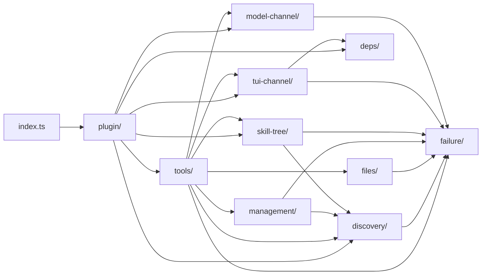

# skill-tools 架构总纲

[English](../docs/architecture.md) | 中文

本文档整理基本功能的架构设计、项目模块拓扑与工程纪律。
如要查看具体功能的架构设计，访问如下文档：

- [工具设计](arch/tools.md)
- [技能加载机制](arch/skill-tree.md)
- [TUI 通道规范](arch/tui-channel.md)
- [模型通道规范](arch/model-channel.md)

## 发现路径

默认情况下有四种发现路径：

| 标识符 | 路径 |
| --- | --- |
| `global` | `{agent_dir}/skills` |
| `project` | `{cwd}/.pi/skills` |
| `package` | 继承 Pi 的发现机制 |
| `temp` | 继承 Pi 的发现机制 |

## 职责边界

### 拓扑关系

```text
skill-tools/
├── index.ts                      接线：导出 createPlugin(pi)
├── src/
│   ├── plugin/                   构建 Pi 插件
│   │   ├── plugin.ts             宿主动态导入、装配、注册
│   │   ├── hooks.ts              会话钩子
│   │   ├── commands.ts           /skill:* 命令
│   │   └── settings.ts           settings.json → 解析后的配置
│   ├── tools/                    十个工具
│   │   ├── types.ts              ToolDeps、ToolResult
│   │   ├── list-skills.ts
│   │   ├── list-skill-tags.ts
│   │   ├── list-skill-files.ts
│   │   ├── preview-skill.ts
│   │   ├── search-skill.ts
│   │   ├── import-skill.ts
│   │   ├── cancel-skill.ts
│   │   ├── create-skill.ts
│   │   ├── rename-skill.ts
│   │   └── remove-skill.ts
│   ├── skill-tree/               已加载技能状态
│   │   ├── types.ts              StateEntry、LoadedSet、SkillTree
│   │   ├── state.ts              状态值与列表代数
│   │   ├── delta.ts              行级差分与中止闸
│   │   ├── log.ts                提交条目与折叠
│   │   ├── block.ts              <SKILL/> 块
│   │   └── assembly.ts           写入序、导航、偏离修复、上报
│   ├── discovery/                技能目录与寻址
│   │   ├── types.ts              Index、RegistryEntry、SkillStorage
│   │   ├── registry.ts           索引构建
│   │   ├── skill-id.ts           ID 语法与解析
│   │   └── frontmatter.ts        YAML 元数据
│   ├── files/                    文件读取
│   │   ├── read.ts               防逃逸、整份读取、二进制嗅探
│   │   ├── list.ts               目录遍历
│   │   └── section.ts            章节抽取
│   ├── management/               技能写操作
│   │   ├── types.ts              ManagementPorts
│   │   ├── create.ts
│   │   ├── rename.ts
│   │   └── remove.ts
│   ├── tui-channel/              TUI 通道
│   │   ├── types.ts              传输载荷家族
│   │   ├── payload.ts            构造与守卫
│   │   ├── presentation.ts       行投影
│   │   ├── cards.ts              逐工具卡片
│   │   └── status.ts             状态栏
│   ├── model-channel/            模型通道
│   │   ├── output.ts             逐工具输出文本
│   │   ├── failure-text.ts       ErrorCode / Reason / Suggestion
│   │   └── guidance.ts           系统提示追加
│   ├── failure/                  失败词汇
│   │   ├── types.ts              Failure、FailureCode
│   │   ├── codes.ts              闭集与恢复文本
│   │   └── create.ts             Failure 构造
│   └── deps/                     宿主边界
│       ├── pi-tui.ts
│       ├── pi-theme.ts
│       └── tail-prompt.ts
└── tests/                        与 src 同构
```



> [!NOTE]
> 模块之间的依赖单向，无环。
> 箭头自主向被依赖方。

`tools/` 是全系统唯一的组合层：它同接两条通道与四个领域模块，两条通道不反向依赖它。
`plugin/` 是唯一同时接触宿主与全部模块的地方，`index.ts` 只调用它。

### 模块职责

| 模块 | 职责 | 对外关键符号 | 依赖 |
| --- | --- | --- | --- |
| `plugin/` | 构建 Pi 插件：宿主动态导入、装配、注册工具、钩子与命令 | `createPlugin`, `ResolvedConfig` | `tools/`, `skill-tree/`, `discovery/`, `model-channel/`, `tui-channel/`, `deps/` |
| `tools/` | 十个工具：参数定义、执行编排、两通道接线 | `ToolDeps`, `ToolResult`, `define*Tool` | `discovery/`, `files/`, `management/`, `skill-tree/`, `tui-channel/`, `model-channel/`, `failure/` |
| `skill-tree/` | 已加载技能状态：两层存储、差分、折叠、写入序、导航、挂载 | `createSkillTree`, `SkillTree`, `SkillTreePorts`, `StateEntry`, `ChangeRequest` | `discovery/`, `failure/` |
| `discovery/` | 技能目录与寻址：索引构建、ID 语法、Frontmatter 元数据 | `buildIndex`, `Index`, `RegistryEntry`, `parseSkillId`, `formatSkillId`, `resolveSkillId`, `matchesFrontmatter`, `parseFrontmatterBlock`, `collectTags` | `failure/` |
| `files/` | 文件读取：防逃逸、整份读取、二进制嗅探、目录遍历、章节抽取 | `resolveSkillFile`, `readSkillFile`, `listSkillFiles`, `extractSection` | `failure/` |
| `management/` | 技能写操作：创建、重命名、移除，含原子写与覆盖保护 | `createSkill`, `renameSkill`, `removeSkill`, `ManagementPorts` | `discovery/`, `failure/` |
| `tui-channel/` | TUI 通道：传输载荷家族、行投影、逐工具卡片、状态栏 | `TransportPayload`, `build*Payload`, `presentRow`, `renderStatus` | `deps/`, `failure/` |
| `model-channel/` | 模型通道：逐工具输出文本、失败文本框架、系统提示追加 | `*Text`, `failureText`, `guidanceText` | `failure/` |
| `failure/` | 失败词汇：闭集失败码、恢复文本、Failure 构造 | `FAILURE_CODES`, `FailureCode`, `Failure`, `createFailure`, `recoveryFor` | 无 |
| `deps/` | 宿主边界：唯一具名宿主包处 | `Text`, `Box`, `Container`, `visibleWidth`, `sliceByColumn`, `ThemeFg`, `TAIL_PROMPT_*` | 无 |

一个目录一个职责，模块的契约就是它导出的符号。

安全与性能算法——路径防逃逸、二进制嗅探、整份读取、原子写、差分中止闸——留在 `files/`、`management/`、`skill-tree/` 内。
它们不随功能变动而改变，也不造成功能变动，仅遵循编码原则与相关官方规范，本文因此不解释其实现。

## 错误处理

### 失败携带结构化证据

失败不抛出，而返回 `isError: true`。

Pi 在抛出时用 createErrorToolResult 顶替结果，其 details 为 {}。
返回式则保留 details 与 structuredContent，而模型看到的 content 与抛出完全相同。

因此失败的 details 与成功同构，终端渲染层直接从结果取用，不需要额外通道。

抛出仍留给非预期错误，由框架兜底。

### 闭集错误码体系

以功能为类别，逐类穷举异常。
一个码对应一种异常，不描述具体发生了什么：具体信息进证据，恢复是可执行的下一步。

同一恢复覆盖的情形合成一个码，差异进证据。
不可达的异常，以及代理无法处置、只能上报的异常，不设码。

| 功能 | 码 | 异常 | 证据 | 恢复 |
| --- | --- | --- | --- | --- |
| 寻址 | `ID_NAME_INVALID` | 名称部分为空，或含 `^[a-z0-9-]+$` 以外的字符 | 原输入 | 名称只含小写字母、数字与连字符 |
| 寻址 | `ID_LOCATION_UNKNOWN` | 位置前缀不是已注册的发现路径 | 已注册的位置 | 唯一时省略前缀，或改用已注册的位置 |
| 寻址 | `ID_NOT_FOUND` | 索引里没有该技能 | 名称最接近的若干技能 | 用 `list_skills` 或 `search_skill` 找到名称 |
| 寻址 | `ID_AMBIGUOUS` | 同名技能出现在多个位置 | 每个候选的完整 ID | 用带位置前缀的完整 ID 重试 |
| 寻址 | `REF_PATH_INVALID` | 相关文件路径是绝对路径，或越出技能目录 | 原输入 | 用技能目录内的相对路径 |
| 读取 | `PATH_NOT_FOUND` | 目标不存在 | 绝对路径 | 用 `list_skill_files` 确认可用文件 |
| 读取 | `READ_FAILED` | 目标存在但读不出 | 绝对路径与底层错误 | 检查该路径的权限；读不出时该技能不可用 |
| 读取 | `FILE_NOT_TEXT` | 目标是二进制 | 绝对路径 | 不要用本工具读取二进制文件 |
| 读取 | `SECTION_NOT_FOUND` | 目标文件没有该章节 | 章节名与绝对路径 | 省略 `section` 读全文，或换一个章节名 |
| 检索 | `FILTER_INVALID` | 过滤值不是合法正则 | 过滤键与模式 | 修正模式，或改用字符串包含 |
| 加载 | `BATCH_EMPTY` | 批量操作没有给出任何 ID | 无 | 至少给出一个 ID |
| 加载 | `NOT_LOADED` | 取消的身份不在加载树里 | 该 ID 与当前已加载的 ID | 用 `/skill:loaded` 确认后再取消 |
| 管理 | `LOCATION_READ_ONLY` | 目标位置不可写 | 位置 | 改用可写位置，或把该位置改为可写 |
| 管理 | `TARGET_EXISTS` | 索引里已有同名技能，或磁盘上已有同名目标 | 冲突对象的 ID 或绝对路径 | 换一个名称，或先移除既有对象 |
| 管理 | `WRITE_FAILED` | 写入、移动或删除失败 | 绝对路径与底层错误 | 检查权限与可用空间后重试 |
